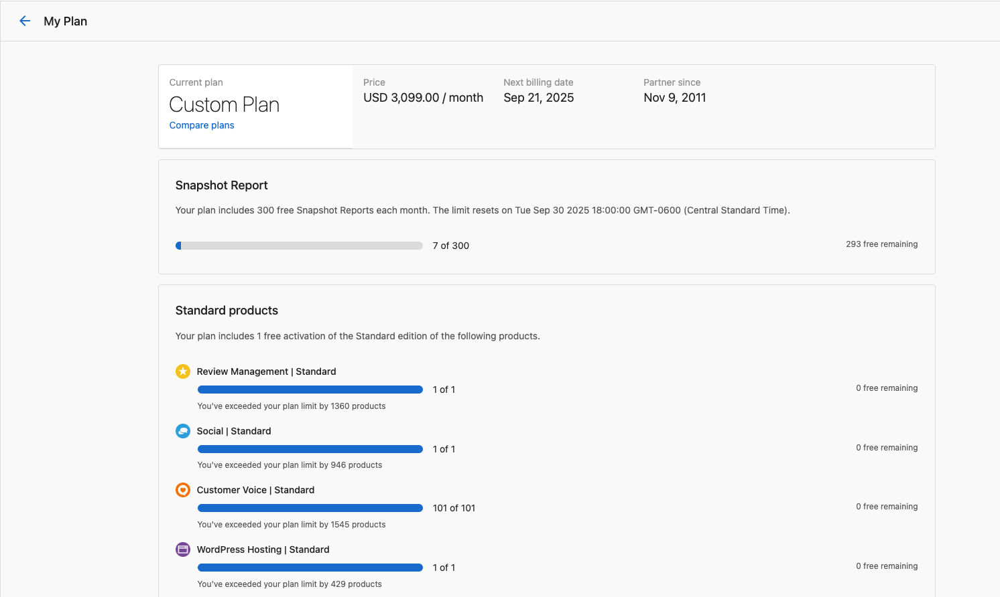
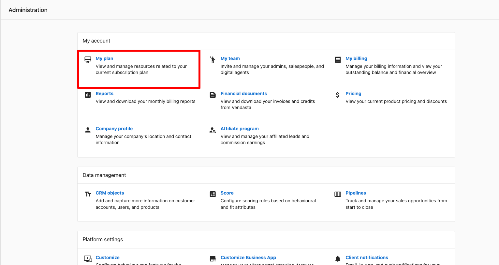

To view your Vendasta plan, go to `Administration` → `My account` → `My plan` in Partner Center. To cancel a Starter plan, submit the cancellation form at least 48 hours before renewal; to cancel a contracted plan, contact your account manager or email support@vendasta.com. This page also covers trial subscriptions and how ending your own subscription differs from canceling a client's product or deleting a client account.

## How do I view my Vendasta plan details? {#view-your-subscription-plan-details}

Go to `Partner Center` → `Administration` → `My account` → `My plan` to see your current plan, its price, and your next billing date. From this page you can click `Compare plans` to see other plans, or `Talk to an expert` to discuss your plan with Vendasta.

{/* SME: The live My plan page (checked Oct 30, 2026) shows current plan, price, next billing date, Talk to an expert, and Compare plans. This article previously also said the page shows billing frequency, plan limits used, and free items remaining. Are those still shown, and where? */}

**How does it work?** Access this page from `Partner Center` → `Administration` → `My account` → `My plan`.

## What happens when my Vendasta trial ends? {#trial-subscriptions}

Partners may receive a trial subscription from a Vendasta representative, providing limited-time access to higher-tier features.

- The trial can be **canceled at any time** prior to the expiry date set by your Vendasta representative. At the time of cancellation, the Sales representative will confirm which Admin to leave on the account and remove all other admins.
- If a **contract is signed** while the partner is still on a trial, the trial will be canceled first before the contract is processed.
- If the trial **expires** and the partner does not sign a contract, access reverts to the standard **Free** tier.

:::info
For questions about your trial, contact your assigned Client Success team in the bottom left corner of Partner Center.
:::

## How do I cancel my Vendasta subscription? {#canceling-your-subscription}

There is no cancel or downgrade button in `My plan` or `My billing`. How you end your Vendasta subscription depends on your plan.

### Starter plans

If you're on a Starter plan, cancel your subscription by filling out [this form](https://docs.google.com/forms/d/e/1FAIpQLSdt1tIsvoyiETY0ZQLLe0vzn-xras9xJMGNgOs7eRv50Jb1pA/viewform).

{/* SME: The Compare plans FAQ "How do I end a Vendasta subscription?" (checked Oct 30, 2026) names only Starter plans for the form. This article previously also listed Startup and Individual plans. Do Startup and Individual plans still exist, and do they use the same form? Is the linked Google Form the current one? */}

Cancellations must be submitted **48 hours prior to renewal** to avoid additional subscription charges and are processed within **2 business days**.

**Important notes after cancellation:**

{/* SME: The four notes below are not confirmed by the live platform check on Oct 30, 2026. Please confirm they are still accurate. */}

- Accounts with **paid apps and services** continue to renew and can still be used until canceled.
- **Standard products** in excess of one become billable upon renewal.
- Accounts with **active billing automations** continue to bill and collect unless you toggle them off.
- **Additional team member seats** continue to bill unless you delete them from Partner Center.

### Contracted plans

To cancel or downgrade a contracted subscription, contact your account manager or email [support@vendasta.com](mailto:support@vendasta.com).

{/* SME: Confirm the contract-term charges statement below. The live check on Oct 30, 2026 only confirmed "contact your account manager or email support@vendasta.com". */}

You continue to be charged for active products and subscriptions for the committed length of your contract terms. Refer to the [Terms of Service](https://www.vendasta.com/terms/) and deactivate products to avoid unnecessary charges.

If you have questions about your plan or need to make changes to your subscription, contact our support team.

## Ending your subscription, canceling a client's product, or deleting a client account {#subscription-vs-client-cancellation}

Ending your own Vendasta subscription, canceling a product or subscription for one of your clients, and deleting a client account are separate actions in separate places. Use the table to find the one you need.

| What you want to do | Where to do it | What it affects |
|---|---|---|
| End your own Vendasta subscription | Starter plans: the [cancellation form](#canceling-your-subscription). Contracted plans: your account manager or support@vendasta.com | Your plan with Vendasta |
| Cancel a client's product | `Accounts` → `Manage Accounts` → open the account → `Overview` → `Products` card → the product's **⋮** menu → `Cancel product` | That product and its add-ons, for that account |
| Cancel a client's subscription | Open the account → `Subscriptions` tab → the subscription's **⋮** menu → `Cancel subscription` | That subscription, for that account |
| Delete a client account | Open the account → `More` menu in the account header → `Delete account` | The whole client account and its data |

- For the product cancellation steps and timing options, see [Cancel products](../../../accounts/manage-accounts/product-management.mdx#cancel-products).
- For what account deletion removes, see [Delete accounts](../../../accounts/manage-accounts/delete-accounts.mdx).

:::info
Your clients can also ask to close their own account in Business App from `Administration` → `Delete Account`. This sends you a request to review; nothing is deleted right away.
:::

### Can I close my whole partner account? {#close-partner-account}

You can't close or delete your whole partner (agency) account yourself; there is no option for it in Partner Center. To ask about closing your partner account, email [support@vendasta.com](mailto:support@vendasta.com).

{/* SME: What happens to client accounts, their products, their Business App access, and their billing when a partner (agency) account is closed? The live check on Oct 30, 2026 found no self-serve option and did not confirm the impact on clients. Also confirm support@vendasta.com is the right contact for partner account closure. */}

## Frequently asked questions

Where is the cancellation form for my Vendasta plan?

If you're on a Starter plan, cancel with [this cancellation form](https://docs.google.com/forms/d/e/1FAIpQLSdt1tIsvoyiETY0ZQLLe0vzn-xras9xJMGNgOs7eRv50Jb1pA/viewform). Submit it at least 48 hours before renewal; cancellations are processed within 2 business days.

How do I cancel a contracted Vendasta plan?

Contact your account manager or email [support@vendasta.com](mailto:support@vendasta.com). You're charged for active products and subscriptions for the committed length of your contract.

Do my clients' products and billing stop when I cancel my plan?

{/* SME: Not confirmed by the live check on Oct 30, 2026. Confirm this answer, and whether it differs from closing the whole partner account (see the close-partner-account section). */}

No. Paid apps and services keep renewing until you cancel them, and active billing automations keep billing unless you turn them off. Additional team member seats also keep billing until you delete them.

What happens if my trial expires without a contract?

Your access reverts to the standard Free tier.

Where can I compare Vendasta plans?

Click `Compare plans` in `Administration` → `My account` → `My plan` to see details about other plans.

What is the difference between the Free plan and Starter?

{/* SME: The plan details in this answer were not confirmed by the live check on Oct 30, 2026. */}

The Free plan gives limited platform access for exploring and reselling, but wholesale costs and available products can be more restricted. Starter is the entry paid partner plan: it is co-branded (not full white-label), billed month to month, and keeps Marketplace, CRM, and AI access that Free may limit. Voice receptionist is not included as part of the partner platform on Starter. Check `Administration` → `My account` → `My plan` for the current offer and pricing on your account.

Is canceling my Vendasta plan the same as canceling a client's product?

No. Canceling your plan ends your own subscription with Vendasta. Canceling a client's product stops that product for one client account, from `Cancel product` on the account's `Products` card. See [Ending your subscription, canceling a client's product, or deleting a client account](#subscription-vs-client-cancellation).

Can I delete my partner account?

No, not yourself. There is no option to close or delete your whole partner account in Partner Center. Email [support@vendasta.com](mailto:support@vendasta.com) to ask about closing it.

{/* SME: Same question as the close-partner-account section: what happens to clients when a partner account is closed? */}

